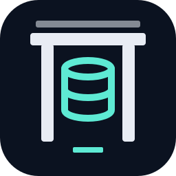

<div align="center">



# 扉 &nbsp;tobira

### Every database, one terminal.

*One CLI and terminal UI to browse, query and explain SQL, document, key-value, time-series and
vector databases, with a read-only guard built in.*

[](https://pkg.go.dev/github.com/xavidop/tobira)
[](https://github.com/xavidop/tobira/actions/workflows/ci.yml)
[](LICENSE)

</div>

---

`tobira` (扉, Japanese for *door*) is one entry point to every database you work with: one
binary, one set of keys and one connection config, whether the database is PostgreSQL, SQLite, a
document store, a cache or a vector index.

<p align="center">
  
</p>

## Why

Every database ships its own client, with its own shell, flags and way of showing a table. You end
up with five tools, five config files and five sets of habits.

With tobira you browse, query and edit all of them from one terminal app, with the same keys and
commands everywhere. A read-only guard sits in front of every driver, so you can browse production
without worrying about an accidental write.

**AI ready.** Ask questions in plain language with `tobira ask` or the AI panel, using Gemini,
OpenAI, Anthropic or a local Ollama model. `tobira mcp` lets Claude Code, Cursor and other agents
query the connections you choose, and an [agent skill](skills/tobira/) teaches your coding agent
the whole CLI.

**Built for scripts and CI.** `tobira query` prints JSON, NDJSON or CSV and returns clear exit
codes, and `tobira doctor` checks your setup in a pipeline, so the same tool works on your laptop
and in CI.

## Install

- **Homebrew (macOS):** `brew install xavidop/tap/tobira`. This is a Homebrew cask, so it is macOS only.
- **Release binaries (Linux, macOS, Windows):** download an archive for amd64 or arm64 from
  [GitHub Releases](https://github.com/xavidop/tobira/releases), check it against
  `checksums.txt`, unpack it and put `tobira` on your `PATH`.
- **Go:** `go install github.com/xavidop/tobira/cmd/tobira@latest` (Go 1.26 or newer).

To build from source, see [CONTRIBUTING.md](CONTRIBUTING.md). After you install, run
`tobira doctor` to check your setup. More options are on the
[install page](https://xavidop.github.io/tobira/docs/install/).

## Quick start

```bash
tobira                                  # open the terminal UI on your configured connections
tobira connect sqlite:./app.db          # or on one connection or DSN (no config file needed)
tobira connections add                  # add a connection with a form
tobira connections add --name app --driver sqlite --dsn sqlite:./app.db   # or with flags
tobira query sqlite:./app.db "select * from users" --format table
tobira query sqlite:./app.db "delete from users" --read-only   # refused, exit code 4
```

Name a connection in `~/.config/tobira/config.yaml` and use the name instead of the DSN:

```yaml
connections:
  - name: local-pg
    dsn: postgres://app@localhost:5432/app?sslmode=disable
    password: env:LOCAL_PG_PASSWORD
    read_only: true
```

```bash
tobira query local-pg "select now()"
```

## Features

- **Terminal UI.** A sidebar of connections and collections, a data grid with paging, sort and
  filters, a row detail tree, mouse support, themes and a vim keymap.
- **Query editor.** Highlighting for each dialect, completion, history, result tabs, `:explain` and
  cancellation.
- **Inline editing.** Edit, insert and delete rows, review the pending changes, then `:apply` them,
  in one transaction where the database has them.
- **Views for each kind of database.** Document previews, key-value types and TTLs, time-series
  charts, wide-column key badges, search scores and vector similarity search.
- **Live tail.** `W` in the TUI or `tobira watch` streams change events from PostgreSQL, Greenplum,
  MongoDB, Redis, DynamoDB, Firestore and Cosmos DB.
- **`tobira query`.** Run one query and print a table, JSON, NDJSON or CSV, or stream a result of
  any size into a file with `--output`.
- **AI assistant.** Ask questions in plain language, in the TUI or with `tobira ask`. See
  [AI & MCP](#ai--mcp).
- **MCP server.** `tobira mcp` gives an MCP client such as Claude Code access to the connections
  you choose.
- **Connections and secrets.** Passwords are references (`env:`, `file://`, dotenv or the OS
  keyring), never stored in the config. Import connections from DBeaver, TablePlus or
  `~/.pgpass`, and export them to another machine.
- **`tobira doctor`.** One command checks the config, connections, secrets, drivers, plugins, AI,
  MCP and file permissions.
- **Query history.** Every query that tobira, the assistant or an MCP client runs is logged
  locally, with credentials masked.
- **Driver plugins.** Add a database as an external `tobira-driver-<name>` program in any language.
  `tobira driver install` requires a `--sha256` checksum.

## Drivers

tobira ships thirty-one drivers in the binary, plus DuckDB as an external plugin. Elasticsearch and
OpenSearch share one row but count as a driver each; pgvector is part of the PostgreSQL driver.

| Driver | Kind | Browse | Explain | Vector search | Time series | Other capabilities | Tested against |
|---|---|---|---|---|---|---|---|
| SQLite | SQL | yes | yes (no `ANALYZE`) | no | no | editing, transactions, completion, read-only guard | real database |
| PostgreSQL | SQL | yes | yes (`ANALYZE` rolled back) | yes (pgvector extension) | no | editing, transactions, completion, export, watch, read-only guard | real server |
| MySQL | SQL | yes | yes (no `ANALYZE`) | no | no | editing, transactions, completion, read-only guard | real server |
| MariaDB | SQL | yes | yes (no `ANALYZE`) | no | no | editing, transactions, completion, read-only guard | real server |
| SingleStore | SQL | yes | yes (no `ANALYZE`) | no | no | editing, completion | MySQL and MariaDB (SingleStore mode) |
| CockroachDB | SQL | yes | yes (`ANALYZE` rolled back) | no | no | editing, transactions, completion, export, read-only guard | real server |
| Amazon Redshift | SQL | yes | yes (text plan, no `ANALYZE`) | no | no | completion, read-only guard | PostgreSQL 17 (Redshift mode) |
| Greenplum | SQL | yes | yes (`ANALYZE` rolled back) | yes (pgvector extension) | no | editing, transactions, completion, export, watch, read-only guard | PostgreSQL 17 (Greenplum mode) |
| SQL Server | SQL | yes | yes (estimated plan, never runs) | no | no | editing, transactions, completion, read-only guard | real server |
| Oracle | SQL | yes | yes (estimated plan, never runs) | no | no | editing, transactions, completion, read-only guard | real server |
| libSQL / Turso | SQL | yes | yes (no `ANALYZE`) | no | no | editing, transactions, completion, read-only guard | real server (sqld) |
| Cloudflare D1 | SQL | yes | yes (no `ANALYZE`) | no | no | editing, completion, read-only guard | local fake of the D1 API |
| ClickHouse | Columnar SQL | yes | yes (no `ANALYZE`) | no | no | completion, export, read-only guard | real server |
| BigQuery | Columnar SQL | yes | yes (dry run: bytes and schema; no `ANALYZE`) | no | no | completion, read-only guard | BigQuery emulator |
| Snowflake | Columnar SQL | yes | yes (`EXPLAIN USING TEXT`, never runs; no `ANALYZE`) | no | no | editing, transactions, completion, read-only guard | local fake (fakesnow) |
| Vertica | Columnar SQL | yes | yes (plan only, no `ANALYZE`) | no | no | editing, transactions, completion, read-only guard | real server |
| MongoDB | Document | yes | yes (`executionStats`, never applies a write) | no | no | editing, completion, watch, read-only guard | real server |
| Cloud Firestore | Document | yes | no | no | no | editing, completion, watch (snapshot listeners), read-only guard | Firestore emulator |
| Azure Cosmos DB | Document | yes (continuation tokens) | no | yes (`VectorDistance`; L2, cosine, inner product; text with an embedder) | no | editing (ETag match), completion, watch (change feed), read-only guard | Cosmos DB emulator |
| Redis | Key-value | yes | no | no | no | editing, watch, read-only guard | real server |
| Amazon DynamoDB | Key-value | yes | no | no | no | editing, completion, watch (Streams), read-only guard | DynamoDB Local |
| Cassandra | Wide-column | yes (paging state; tobira-side sort up to 10,000 rows) | no | no | no | editing (conditional writes), completion, read-only guard | real server |
| Neo4j | Graph | yes (offset pages over a label) | yes (`EXPLAIN`; `PROFILE` runs it) | no | no | graph neighbourhood, read-only guard (server-enforced) | real server |
| Elasticsearch / OpenSearch (2 drivers) | Search | yes (`search_after` on a point in time) | yes (`_validate/query`, never runs; `ANALYZE` runs the search with profiling) | Elasticsearch: yes (kNN on `dense_vector`, exact `script_score` for other metrics; text with an embedder); OpenSearch: no | no | editing, read-only guard | real servers |
| InfluxDB | Time series | yes | no | no | yes (windowed ranges, SQL or InfluxQL) | read-only guard | real server |
| Qdrant | Vector | yes | no | yes (per-vector metric, text with an embedder) | no | editing, read-only guard | real server |
| pgvector (part of PostgreSQL) | Vector | yes | yes | yes (L2, cosine, inner product; text with an embedder) | no | read-only guard | real server |
| Pinecone | Vector | yes (list order; tobira-side filters, sort up to 10,000 records) | no | yes (index metric, text with an embedder) | no | editing, read-only guard | Pinecone Local |
| Weaviate | Vector | yes (cursor API; offset pages when filtered or sorted) | no | yes (per-vector metric, text with an embedder) | no | editing, read-only guard | real server |
| Chroma | Vector | yes (Chroma's order; tobira-side sort up to 10,000 records; server-side filters) | no | yes (collection's space, text with an embedder) | no | editing, read-only guard | real server |
| Milvus | Vector | yes (primary-key order; sorted by tobira up to 10,000 entities) | no | yes (index metric; text via BM25/TEXTEMBEDDING functions or an embedder) | no | editing, read-only guard | real server (2.6 standalone) |
| DuckDB (plugin) | SQL | yes | yes (`EXPLAIN`; `ANALYZE` runs it, on read-only paths only for reads) | no | no | editing, transactions, completion, read-only guard | real database |

**Compatibility.** "Real server" means the database itself. A driver tested against an emulator
or a local fake has not yet been tested against the cloud service. Redshift and Greenplum are
tested by running the PostgreSQL suite in Redshift or Greenplum mode, and SingleStore by running
the MySQL and MariaDB suites in SingleStore mode; none has been tested against a real cluster yet.
The read-only guard of the MySQL family needs MySQL 8.0 to 8.4 or MariaDB 11.1 to 11.x.

**DuckDB** is an external plugin, not part of the binary. The
[DuckDB page](https://xavidop.github.io/tobira/docs/drivers/duckdb/) shows how to download it from
its GitHub release or build it from source.

**Read-only guard** means a query run read-only cannot write, whatever its text says. SingleStore
has no read-only transaction, so tobira refuses read-only connections to it. The
[drivers page](https://xavidop.github.io/tobira/docs/drivers/) has each driver's DSN and options,
and the [security page](https://xavidop.github.io/tobira/docs/security/) lists what each guard
cannot stop.

## AI & MCP

### AI assistant

Add an `ai:` section to the config file and pick a provider:

```yaml
ai:
  provider: googleai            # googleai, vertexai, anthropic, openai or ollama
  api_key: env:GEMINI_API_KEY   # a secret reference, never the key itself
  send_rows: ask                # ask, always or never
```

```bash
tobira ask local-pg "orders per day last week" --collection public.orders   # proposes a query
tobira ask local-pg "the ten newest orders" --run                            # proposes, then runs it read-only
tobira ask local-pg "how many users signed up today?" --answer               # runs read-only queries
```

- **Where.** Press `a` in the terminal UI, or run `tobira ask`.
- **What it does.** It proposes a query, answers a question by running read-only queries, explains
  a result and fixes a failed query.
- **What it sends.** The schema (never DDL), your question and, if `ai.send_rows` allows it, row
  data. `never` keeps rows back, but it is not a hard security boundary against a hostile model.
- **Writes.** Only in the terminal UI, after `:ai execute on`, and you confirm each statement.

See the [AI page](https://xavidop.github.io/tobira/docs/ai/).

### MCP server

`tobira mcp` lets an MCP client (Claude Code, Claude Desktop, Cursor, VS Code) use your
connections. Nothing is exposed until you name it:

```sh
claude mcp add tobira -- tobira mcp --expose local-pg,cache
```

```yaml
mcp:
  expose: [local-pg, cache]   # the only connections a client can see
  allow_writes: [cache]       # a subset of expose; the rest stay read-only
  max_rows: 200               # 1 to 1000
  send_rows: always           # always or never
```

- **Tools.** `list_connections`, `list_namespaces`, `list_collections`, `describe`, `sample`,
  `query` and `explain`, all read-only; `similar` when an exposed connection supports vector
  search; and `execute` only when `allow_writes` is not empty.
- **Rows.** `send_rows` defaults to `always` here, because nobody is there to answer a prompt. Do
  not expose a connection whose data must not reach the model.
- **HTTP.** `--http 127.0.0.1:8765` serves over HTTP with a bearer token, on loopback only unless
  you pass `--insecure-bind`.
- **History.** `tobira history --mcp` shows what each client ran.

Setup for each client is on the [MCP page](https://xavidop.github.io/tobira/docs/mcp/). A small
Go client is in [`examples/mcp-client`](examples/mcp-client/).

## CLI

```text
tobira                               open the terminal UI (on a terminal)
tobira connect <connection|dsn>      open the terminal UI on one connection
tobira connections list|add|edit|rm|test|set-password|export|import   manage, export and import connections
tobira query <connection|dsn> [q]    run a query and print the result (--output writes a file)
tobira watch <connection|dsn> <target>   stream change events as JSON lines (--max, --timeout)
tobira ask [connection] <question>   ask the AI assistant (--run runs the proposal read-only, --answer answers)
tobira mcp --expose <names>          serve connections to an MCP client (--http for HTTP)
tobira history                       list the queries tobira ran, newest first (--source, --mcp)
tobira driver list|info|install      list drivers and plugins, inspect one, install a plugin (--sha256)
tobira doctor                        check the config, connections, secrets, plugins, AI and MCP (--no-ping)
tobira version                       print the version, commit and build date
```

Every flag, output format and exit code is in the
[CLI reference](https://xavidop.github.io/tobira/docs/cli/).

## Agent skill

Teach your AI coding agent (Claude Code, Cursor, Copilot and others) to use tobira with the
[agent skill](skills/tobira/). It covers every command, the MCP setup, drivers and plugins.

```bash
npx skills add xavidop/tobira
```

## Documentation

- [Docs site](https://xavidop.github.io/tobira/docs/): quick start, the terminal UI, configuration
  and troubleshooting
- [Install](https://xavidop.github.io/tobira/docs/install/)
- [Drivers](https://xavidop.github.io/tobira/docs/drivers/): DSNs, options and capabilities for each
  database
- [AI assistant](https://xavidop.github.io/tobira/docs/ai/) and
  [MCP server](https://xavidop.github.io/tobira/docs/mcp/)
- [CLI reference](https://xavidop.github.io/tobira/docs/cli/)
- [Security](https://xavidop.github.io/tobira/docs/security/) and [SECURITY.md](SECURITY.md)
- [Go API reference](https://pkg.go.dev/github.com/xavidop/tobira)

## Contributing

Contributions are welcome, especially new drivers. Run `make all` before you send a change. See
[CONTRIBUTING.md](CONTRIBUTING.md) for the repository layout, how to build and test, and the
commit conventions.

## License

[MIT](LICENSE) © Xavier Portilla Edo
